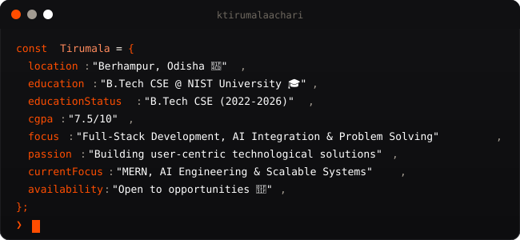

<!-- ROYAL COHESIVE HEADER BANNER -->

  <picture>
    <source media="(prefers-color-scheme: dark)" src="./assets/tirumala-github-banner.svg?v=1">
    <source media="(prefers-color-scheme: light)" src="./assets/tirumala-github-banner.svg?v=1">
    
  </picture>

<!-- SPLIT INTRODUCTION PROFILE GRID -->
<table border="0" cellpadding="10" cellspacing="0" width="100%">
  <tr>
    <!-- Left Column: Virtual ID Card & Lanyard -->
    <td width="30%" align="center" valign="top">
      
       
      

        
      

    </td>
    <!-- Right Column: Personal Bio & Social Links -->
    <td width="70%" valign="top">
      <h2 align="center">▰▰▰ <code>&nbsp;💫&nbsp;ABOUT&nbsp;</code> ▰▰▰</h2>
      
I am a performance-driven <strong>Full Stack Developer</strong> focused on designing and building impactful, user-centric web applications and AI-powered products. I enjoy turning real-world problems into reliable software through clean architecture, thoughtful engineering, and practical AI integration.

  
  

  

#### 🛠️ What I Bring to Your Team:

- **The Full-Stack Mindset:** Adept at building responsive React frontends and secure Node.js/Express backends backed by production-ready databases and APIs.
- **Problem Solving & AI:** Apply data structures, algorithms, and modern AI techniques to build practical, reliable software.

<!-- Social Connection Links -->

  
  
  
  
  

</td>
  </tr>
</table>

<h2 align="center">▰▰▰ <code>&nbsp;💼&nbsp;Professional Experience&nbsp;</code> ▰▰▰</h2>

### Data Science Using Python (ML & DL) | NIST University

**July 2024 – August 2024 | Berhampur, Odisha**

- 🤖 **Machine Learning & Deep Learning** - Hands-on experience with ML algorithms and neural networks
- 📊 **Data analysis & model optimization** using Python, scikit-learn, and TensorFlow
- 🎯 **Developed predictive models** for real-world data science applications

### MERN Full Stack Web Development | NIST University

**June 2026 – June 2026 | Berhampur, Odisha**

- 🎓 **Summer Course Completion** - Advanced full-stack development with production-ready applications
- 🔧 **Built scalable web applications** using MongoDB, Express.js, React.js, and Node.js
- 📱 **Implemented REST APIs & Authentication** for secure, enterprise-grade systems

<h2 align="center">▰▰▰ <code>&nbsp;⚡&nbsp;Currently Building & Learning&nbsp;</code> ▰▰▰</h2>

 

&nbsp;

&nbsp;

<h2 align="center">▰▰▰ <code>&nbsp; 🤖 &nbsp;Technical Expertise&nbsp;</code> ▰▰▰</h2>

<table width="100%" border="1" cellpadding="0" cellspacing="0">

<!-- IDE & AI TOOLS -->

<tr>
  <td width="20%" align="center" valign="middle">
     
    <strong>IDE & AI Tools</strong>
  </td>

  <td align="center">
     
    <b>VS Code</b>
  </td>

  <td align="center">
     
    <b>IntelliJ IDEA</b>
  </td>

  <td align="center">
     
    <b>Postman</b>
  </td>

  <td align="center">
     
    <b>Cursor AI</b>
  </td>

  <td align="center"> <b>Gmail API</b></td>

  <td align="center"> <b>MS Office</b>
  </td>
  <td width="100"></td>
  <td width="100"></td>
</tr>

<!-- LANGUAGES -->

<tr>
  <td width="20%" align="center" valign="middle">
     
    <strong>Languages</strong>
  </td>

  <td align="center">
     
    <b>Java</b>
  </td>

  <td align="center">
     
    <b>JavaScript</b>
  </td>

  <td align="center">
     
    <b>TypeScript</b>
  </td>

  <td align="center">
     
    <b>HTML5</b>
  </td>

  <td align="center">
     
    <b>CSS3</b>
  </td>

  <td align="center">
     
    <b>Python</b>
  </td>
   <td width="100"></td>
  <td width="100"></td>
</tr>

<!-- CORE CONCEPTS -->

<tr>
  <td width="20%" align="center" valign="middle">
     
    <strong>Core Concepts</strong>
  </td>

  <td align="center">
     
    <b>OOP (Java)</b>
  </td>

  <td align="center">
     
    <b>DSA</b>
  </td>

  <td align="center">
     
    <b>REST APIs</b>
  </td>

  <td align="center">
     
    <b>Real-Time Systems</b>
  </td>

  <td align="center">
     
    <b>WebRTC</b>
  </td>
   <td width="100"></td>
  <td width="100"></td>
  <td width="100"></td>
</tr>

<!-- FRONTEND -->

<tr>
  <td width="20%" align="center" valign="middle">
     
    <strong>Frontend</strong>
  </td>

  <td align="center">
     
    <b>React.js</b>
  </td>

  <td align="center">
     
    <b>Vite</b>
  </td>

  <td align="center">
     
    <b>Three.js</b>
  </td>

  <td align="center">
   
  <b>Next.js</b>
  </td>

  <td align="center">
     
    <b>Bootstrap</b>
  </td>

  <td align="center">
     
    <b>Tailwind CSS</b>
  </td>
  <td width="100"></td>
  <td width="100"></td>
</tr>

<!-- BACKEND -->

<tr>
  <td width="20%" align="center" valign="middle">
     
    <strong>Backend</strong>
  </td>

  <td align="center">
     
    <b>Node.js</b>
  </td>

  <td align="center">
     
    <b>Express.js</b>
  </td>

  <td align="center">
     
    <b>FastAPI</b>
  </td>

  <td align="center">
     
    <b>Socket.IO</b>
  </td>

  <td align="center">
     
    <b>Redis</b>
  </td>

  <td align="center">
     
    <b>RabbitMQ</b>
  </td>
   <td width="100"></td>
  <td width="100"></td>
</tr>

<!-- DATABASES -->

<tr>
  <td width="20%" align="center" valign="middle">
     
    <strong>Databases</strong>
  </td>

  <td align="center">
     
    <b>MongoDB</b>
  </td>

  <td align="center">
     
    <b>PostgreSQL</b>
  </td>

  <td align="center">
     
    <b>Firebase</b>
  </td>

  <td align="center">
     
    <b>MySQL</b>
  </td>
   <td width="100"></td>
  <td width="100"></td>
   <td width="100"></td>
  <td width="100"></td>
</tr>

<!-- CLOUD & DEVOPS -->

<tr>
  <td width="20%" align="center" valign="middle">
     
    <strong>Cloud & DevOps</strong>
  </td>

  <td align="center">
     
    <b>AWS</b>
  </td>

  <td align="center">
     
    <b>Docker</b>
  </td>

  <td align="center">
     
    <b>Kubernetes</b>
  </td>

  <td align="center">
     
    <b>Jenkins</b>
  </td>
  <td width="100"></td>
  <td width="100"></td>
   <td width="100"></td>
  <td width="100"></td>
</tr>

<!-- DEPLOYMENT -->

<tr>
  <td width="20%" align="center" valign="middle">
     
    <strong>Deployment</strong>
  </td>

  <td align="center">
     
    <b>Git</b>
  </td>

  <td align="center">
     
    <b>GitHub</b>
  </td>

  <td align="center">
     
    <b>Vercel</b>
  </td>

  <td align="center">
   
  <b>EmailJS</b>
</td>

  <td align="center">
     
    <b>Render</b>
  </td>

  <td align="center">
   
  <b>Resend</b>
</td>
  <td width="100"></td>
  <td width="100"></td>
</tr>

<!-- AI TOOLS -->

<tr>
  <td width="20%" align="center" valign="middle" rowspan="2">
     
    <strong>AI Tools</strong>
  </td>

  <td align="center">
     
    <b>OpenAI</b>
  </td>

  <td align="center"> <b>Claude</b></td>

  <td align="center">
     
    <b>Gemini</b>
  </td>

  <td align="center">
     
    <b>Ollama</b>
  </td>

  <td align="center">
     
    <b>LangChain</b>
  </td>

  <td align="center">
     
    <b>LangGraph</b>
  </td>
   <td width="100"></td>
  <td width="100"></td>
<tr>
  <td align="center">
     
    <b>Hugging Face</b>
  </td>

  <td align="center">
     
    <b>RAG</b>
  </td>

  <td align="center">
     
    <b>Google Antigravity</b>
  </td>
  <td align="center">
     
    <b>AI Agents</b>
  </td>
  <td align="center">
     
    <b>Codex</b>
  </td>

  <td align="center">
     
    <b>OpenClaw</b>
  </td>
   <td width="100"></td>
  <td width="100"></td>
</tr>
</table>
<h2 align="center">▰▰▰ <code>&nbsp;&nbsp;Areas of Expertise&nbsp;</code> ▰▰▰</h2>

<table>
  <tr>
    <td align="center" width="260">
        
      <h3>⚡ Full-Stack Engineering</h3>
      
<strong>MERN • REST APIs • Authentication</strong> 
      Scalable, secure & production-ready applications

    </td>
    <td align="center" width="260">
      
      <h3>🧠 AI-Powered Development</h3>
      
<strong>LLMs • RAG • AI APIs • Agents</strong> 
      Building intelligent applications with modern AI

    </td>
    <td align="center" width="260">
        
      <h3>☁️ Cloud & DevOps</h3>
      
<strong>Docker • Kubernetes • AWS</strong> 
      Deployment, infrastructure & scalable systems

    </td>
  </tr>
  <tr>
    <td align="center" width="260">
        
      <h3>🧩 DSA & Problem Solving</h3>
      
<strong>Algorithms • Data Structures • Logic</strong> 
      Efficient solutions for real-world problems

    </td>
    <td align="center" width="260">
        
      <h3>🚀 Engineering Workflow</h3>
      
<strong>Git • GitHub • CI/CD • Deployment</strong> 
      From development to production

    </td>
    <td align="center" width="260">
        
      <h3>🗄️ Data & Backend Systems</h3>
      
<strong>SQL • MongoDB • Database Design</strong> 
      Reliable data models & backend architecture

    </td>
  </tr>
</table>

<h2 align="center">▰▰▰ <code>&nbsp;🎯&nbsp;My Projects&nbsp;</code> ▰▰▰</h2>
<table>
  <tr>
    <td width="50%" valign="top">

### 🏢 Enterprise AI CRM & Sales Intelligence

**Industry-Level Multi-Tenant CRM, LLaMA-3 AI Copilot & SaaS Platform**

  
  
  
  
  
  

**Key Features:**

- 🏢 **Multi-Tenant Workspaces:** Strict tenant data isolation by `companyId`, unique 6-digit onboarding join codes, and approval queues.
- 📊 **Visual Kanban Pipeline:** Drag-and-drop deal progression (`Lead` ➔ `Closed-Won`), BANT qualification checklists, and activity tracking.
- 🤖 **Groq LLaMA-3.3 Copilot:** Real-time sales objection handling, tailored cold outreach email generation, and meeting notes summarization.
- 💳 **Tiered SaaS Subscriptions:** Automated Razorpay billing with HMAC signature verification and credit-based usage tiers.
- 🔒 **Enterprise Security & RBAC:** 4-tier role hierarchy, short-lived JWTs, HTTP-only refresh cookies, Google OAuth 2.0, and rate limiting.

**Impact:** Architected an enterprise-grade multi-tenant B2B CRM with isolated workspaces, high-speed LLaMA-3.3 sales intelligence, and automated subscription monetization.

  
  

</td>
<td width="50%" valign="top">

### ⚡ Developer Command Center

**Real-Time Engineering Productivity, DORA Telemetry & AI Observability SaaS**

  
  
  
  
  
  

**Key Features:**

- 📊 **Real DORA Metrics Engine:** Computes Deployment Frequency, Lead Time, Change Failure Rate, and MTTR with interactive 7/30-day Recharts graphs.
- 🤖 **Automated AI PR Reviews:** Google Gemini 1.5 Flash unified diff inspection, OWASP Top 10 security audits, and line-level refactoring hints.
- ⚡ **Cryptographic Webhooks:** Timing-safe HMAC-SHA256 signature verification, GUID deduplication replay protection, and AES-256-GCM encrypted tokens.
- 📡 **Live Telemetry & WebSockets:** Real-time Socket.IO streams for commits, deployments, and PR bottlenecks with a keyboard-first (`Cmd+K`) command palette.
- 🔐 **Dual-Layer Session Auth:** Multi-provider Google & GitHub OAuth 2.0 with HTTP-only `SameSite=None` cookies and Bearer token fallback.

**Impact:** Built a mission-control engineering observability platform unifying GitHub telemetry, live DORA analytics, serverless PostgreSQL, and automated AI security scans.

  
  

</td>
</tr>

<tr>
<td width="50%" valign="top">

### 🍔 Food Flow

**Multi-Vendor Food Delivery PWA with Live GPS Tracking & AI Food Studio**

  
  
  
  
  
  

**Key Features:**

- 📱 **Production PWA Engine:** Service worker cache versioning (`sw.js`), custom install prompts, offline fallback UI, and Web Push notifications.
- 🚴 **Live GPS Delivery Tracking:** Interactive Leaflet & OpenStreetMap dynamic auto-centering with zero-latency Socket.IO room coordination.
- 👑 **4-Tier Ecosystem Portals:** Specialized interfaces for Customers, Restaurant Kitchens (live pipeline), Delivery Riders, and Super Admins.
- 🤖 **AI Food Studio & Concierge:** Google Gemini Vision dish image enhancement and multi-LLM meal advisor (Gemini + DeepSeek).
- 💳 **Dual Checkout & Invoicing:** Razorpay UPI/cards + Cash on Delivery with Delivery OTP, accompanied by automated client-side PDF invoicing (`jsPDF`).

**Impact:** Developed an enterprise-grade multi-vendor food delivery ecosystem featuring Next.js 16 App Router, real-time Leaflet GPS tracking, PWA offline resilience, and automated payments.

  
  

</td>
<td width="50%" valign="top">

### 📄 AI Resume Checker & ATS Optimizer

**Enterprise AI Resume Parsing, Heuristic ATS Scoring & Bullet Rewriter**

  
  
  
  
  
  

**Key Features:**

- 📄 **Context-Aware PDF Parsing:** Server-side in-memory text extraction and structured resume tree compilation (`pdf-parse` + Gemini GenAI).
- 📊 **100-Point ATS Benchmark:** Proprietary 4-quadrant scoring engine evaluating Keywords, Formatting, Impact, and Clarity (0–25 each).
- ✍️ **AI Bullet Quantifier:** Generates quantified before/after bullet upgrades with action verbs, metrics, and strict justification.
- 🔑 **Taxonomy & Keyword Gaps:** Pinpoints missing role competencies and provides real-time historical score evolution charts (`Recharts`).
- 🔄 **Version Diff & PDF Export:** Branch and track multiple resume revisions with dynamic in-browser React-PDF preview and download.

**Impact:** Engineered a full-stack career optimization platform utilizing Google Gemini 2.5 structured schemas, 4-quadrant heuristic scoring, and dynamic PDF resume compilation.

  
  

</td>
</tr>

<tr>
<td width="50%" valign="top">

### 🚀 CodeFlow AI

**Interactive Python Programming Visualization, Step-by-Step Tracer & AI Tutor Platform**

  
  
  
  
  
  

**Key Features:**

- 🖥️ **Interactive Execution Tracer:** Captures every execution step using Python's `sys.settrace`, enabling bidirectional time-travel stepping and live line tracking.
- 🧠 **Live Data Structure Visualizer:** Automatically detects and renders Arrays, Two Pointers, Stacks, Linked Lists, Trees, Graphs, and dynamic Recursion Trees in real time.
- 🤖 **Execution-Aware AI Tutor:** Context-grounded tutor powered by Gemini/OpenAI analyzing live runtime variables, active call stack frames, and AST traces.
- ⚡ **Algorithm Comparison Lab:** Side-by-side execution testing (e.g., Brute-Force vs DP) comparing measured runtimes, step counts, and call stack depth.
- 📚 **Algorithm Library & Studio:** 14 runnable blueprints across 9 categories with guided learning paths and persisted progress in SQLite.

**Impact:** Architected a full-stack code visualization engine with isolated subprocess execution, PEP 578 security audit hooks, AST analysis, and real-time interactive data structures.

  
  

</td>
<td width="50%" valign="top">

### 🎯 WayPoint

**Career Readiness, Adaptive AI Learning Path Recommender & Tech Roadmap Engine**

  
  
  
  
  
  

**Key Features:**

- 🎯 **Intelligent Skill Assessment:** Comprehensive onboarding diagnostic evaluating developer proficiencies to identify domain knowledge gaps.
- 🗺️ **Adaptive AI Roadmaps:** Generates personalized, week-by-week curriculum roadmaps powered by ultra-fast Groq LLMs (Qwen).
- 📊 **Progress Heatmap & Analytics:** Visual daily activity heatmap, task completion velocity metrics, and persistent roadmap tracking.
- 🤖 **Roadmap-Grounded AI Advisor:** Context-aware real-time career guidance copilot personalized to the user's specific learning milestones.
- ⚡ **Sub-Second LLM Inference:** High-throughput JSON generation with cloud Supabase PostgreSQL persistence, JWT auth, and OTP flows.

**Impact:** Engineered an AI-driven career acceleration engine delivering personalized learning roadmaps, sub-second Groq inference, and granular developer readiness analytics.

  
  

</td>
</tr>
</table>

<h2 align="center">▰▰▰ <code>&nbsp;&nbsp;GitHub Activity&nbsp;</code> ▰▰▰</h2>

<table align="center" width="100%">
  <tr>
 <td width="50%" align="center">
      
    </td>
    <td width="50%" align="center">
      
    </td>
  </tr>
</table>

<table align="center" width="100%">
  <tr>
    <td width="50%" align="center">
      
    </td>
    <td width="50%" align="center">
      
    </td>
  </tr>
</table>

<h2 align="center">▰▰▰ <code>&nbsp;📫&nbsp;Let's Connect!&nbsp;</code> ▰▰▰</h2>

I'm always excited to collaborate on innovative projects and discuss technology!

  
  
 

  
  
  <a href="https://www.facebook.com/share/1BSAeSwKVi/" target="_blank">
  
<a href="https://www.instagram.com/k_tiru_mala_achari?igsi=cmFxeTY2ZDlxZnBv" target="_blank">
  
  

  
  

 

  

  <picture>
    <source media="(prefers-color-scheme: dark)" srcset="./assets/pacman-contribution-graph-dark.svg"/>
    <source media="(prefers-color-scheme: light)" srcset="./assets/pacman-contribution-graph.svg"/>
    
  </picture>
  

### ⭐ If you like my work, don't forget to star some repositories!

### 🤝 Let's Build Something Together

**⭐️ From [K Tirumala Achari](https://github.com/ktirumalaachari) — Made with 💜 in Markdown**
